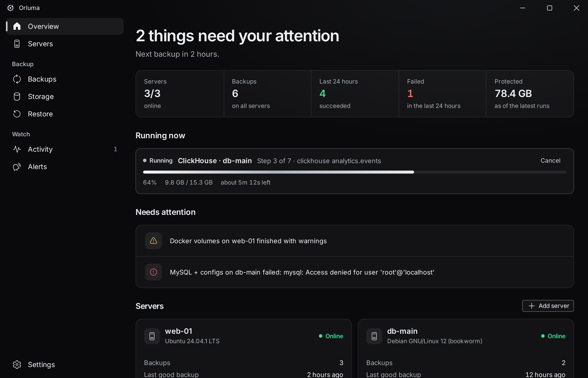
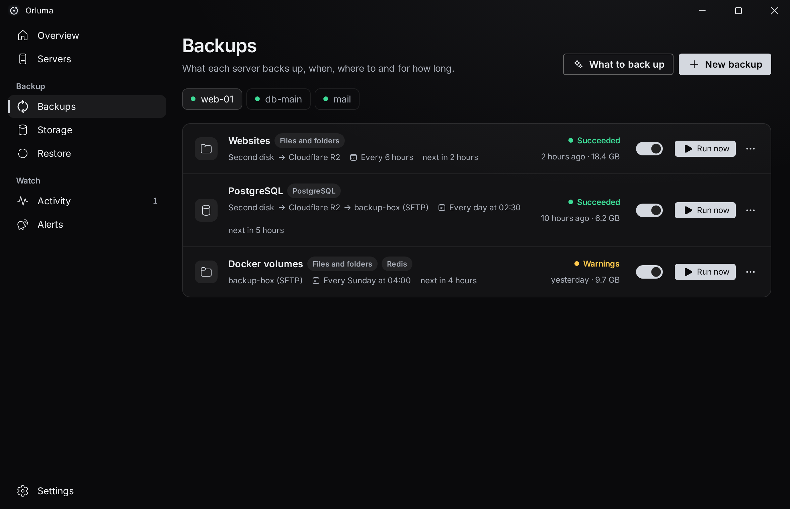
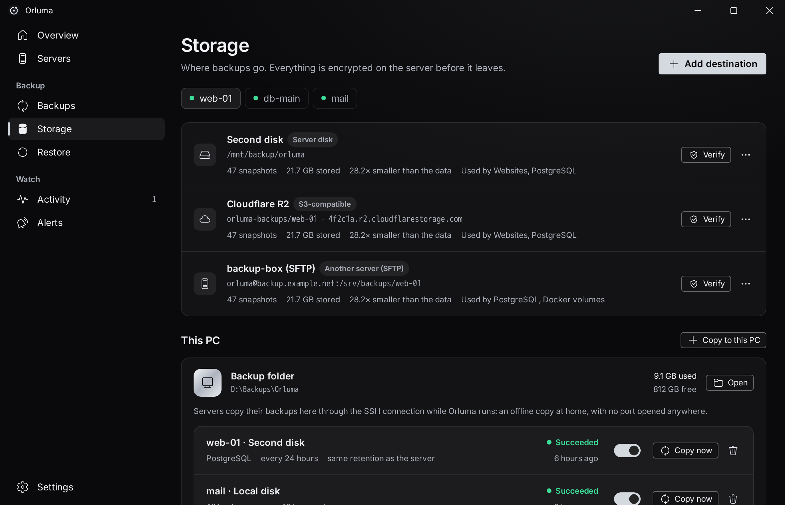
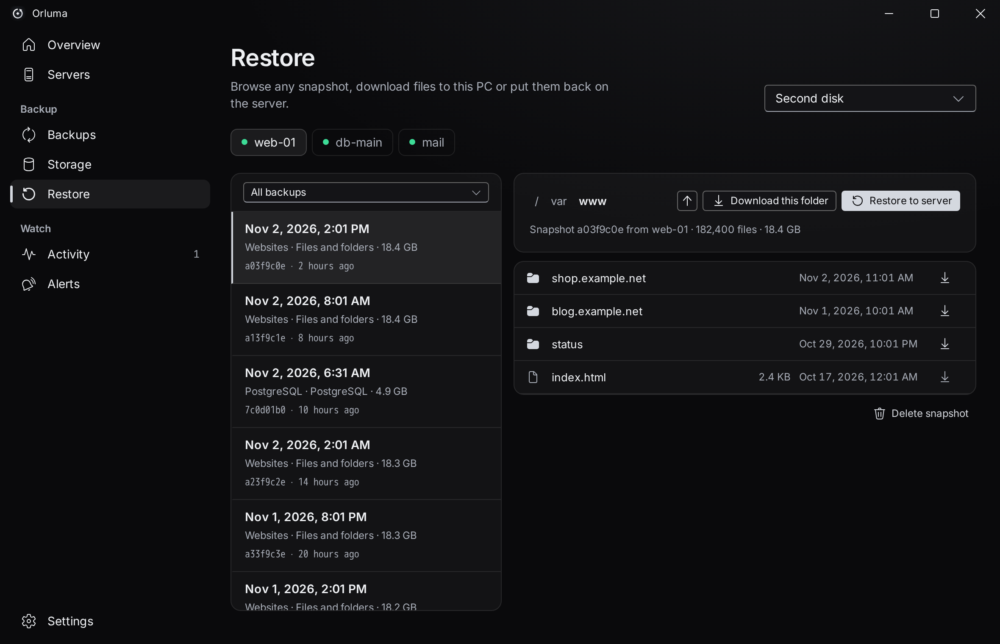
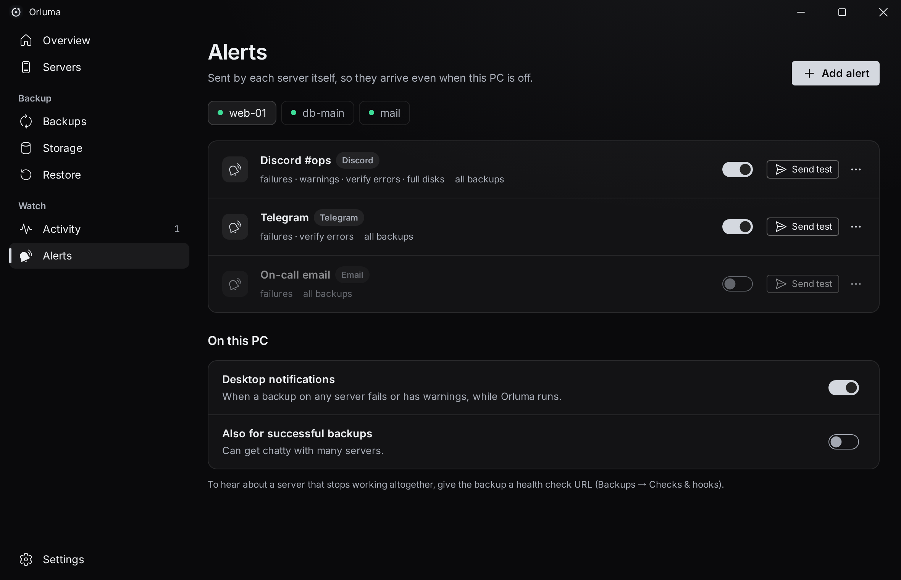

<div align="center">


# Orluma

**Backups for your servers, run from your desktop.**

[](https://github.com/sleax-dev/orluma/actions/workflows/release.yml)
[](https://github.com/sleax-dev/orluma/releases/latest)


[Download](https://github.com/sleax-dev/orluma/releases/latest) · [Changelog](CHANGELOG.md) · [How it works](docs/ARCHITECTURE.md) · [Security](SECURITY.md)



</div>

Orluma puts a small agent on each of your Linux servers and runs their backups for you: on a schedule, encrypted before anything leaves the server, verified by reading the data back, and copied wherever you want it: another server, a cloud bucket, or the PC you are sitting at. The desktop app is the control room for all of it, and the servers send their own alerts, so a failed night is noticed even when your PC is off.

Storage is [restic](https://restic.net): deduplicated, compressed, encrypted, and readable with plain `restic` if Orluma ever disappears.

> Orluma is young. Run a restore on something you can afford to lose before you rely on it, and keep the recovery kit somewhere safe.

## What it does

- **One control room for every server.** Add a server with its address and a root login; Orluma installs the agent, then logs in with its own key. The password is used once and never stored.
- **It tells you what to back up.** The agent finds running databases (services and Docker containers, with the credentials their containers were started with), the usual folders and their sizes. One click makes a daily backup of what you tick.
- **Files and databases, consistently.** Folders, PostgreSQL, MySQL/MariaDB, MongoDB, Redis, SQLite, ClickHouse, or the output of any command. Databases are dumped straight into the repository: no temporary copy on the disk, and a failing dump fails the snapshot instead of saving half a file.
- **Anywhere to send it.** A disk or share on the server, another server over SFTP, S3-compatible storage (AWS, Cloudflare R2, Wasabi, Hetzner, DigitalOcean, Scaleway, iDrive e2, MinIO), Backblaze B2, Azure, Google Cloud Storage, a restic REST server, or any of the 70 clouds rclone reaches. A job can write to one place and copy to others after each good run: the 3-2-1 rule without scripts.
- **A copy on your own PC, with no open port.** Servers push their backups through the SSH connection into a repository inside the app, on a schedule you set, while Orluma runs.
- **Schedules that survive downtime.** Presets or cron, in the server's time zone, with catch-up if the server was off when a run was due.
- **Retention you can read.** Keep the latest N, hourly, daily, weekly, monthly and yearly snapshots; space is freed on its own schedule because that is the slow part.
- **Backups that are proven.** Every repository is read back on a schedule (a share of the data is downloaded and decrypted), and a failed check raises an alert.
- **Restore without a terminal.** Browse any snapshot like a folder, download a file or a whole folder as a zip to this PC, or restore to the server into a folder you choose. Never over live files unless you say so.
- **Alerts that come from the server.** Discord, Telegram, Slack, Microsoft Teams, email (SMTP), ntfy, Gotify, Pushover and signed webhooks, per job and per event, plus health-check pings (healthchecks.io, Uptime Kuma, Cronitor) that also catch a backup that stopped running at all. Desktop notifications on top.
- **Hooks.** Commands before and after a backup, for stopping a service or taking a snapshot of something Orluma does not know about.
- **A recovery kit.** One file with every server, destination and password, so you can restore with restic alone even if the servers and this PC are gone.
- **Updates itself.** The desktop app and the agents install signed releases from GitHub; the signature is checked before anything is replaced.
- **Ten languages**, right-to-left included.

<table>
  <tr>
    <td></td>
    <td></td>
  </tr>
  <tr>
    <td></td>
    <td></td>
  </tr>
</table>

## Install

**Desktop.** Download the installer for your system from [Releases](https://github.com/sleax-dev/orluma/releases/latest): `*-setup.exe` (Windows), `.dmg` (macOS), `.deb` or `.AppImage` (Linux). The installers are not code-signed yet, so SmartScreen or Gatekeeper may warn on first run.

**Servers.** Nothing to download: in the app choose **Add server**, enter the address and a root login, confirm the fingerprint, and Orluma installs the agent. A server needs Linux (x86-64 or ARM64), systemd, and root access over SSH. restic is downloaded by the agent when the server has none, checked against a pinned hash.

## How it keeps your data safe

- **Encrypted before it leaves.** restic encrypts every chunk with a repository password made by Orluma (32 random characters). Storage providers see only ciphertext.
- **No listening ports.** The agent talks on a root-only Unix socket. The app reaches it over SSH, so who can control a server is exactly who can already log in to it as root.
- **Host keys are pinned.** The fingerprint is shown when you add a server and checked on every connection afterwards; a changed key stops the connection before any credential is sent.
- **Signed everything.** Agent binaries and desktop updates are signed with the same minisign key, built into both, and verified before installation.
- **Restores never write over live files by accident.** The target folder must be empty unless you tick the box that says otherwise.
- **No telemetry.** Orluma contacts GitHub (updates) and your own servers and destinations. Nothing else.

The passwords live in `/etc/orluma/agent.json` on each server (root only, mode 600) and in the app's data folder on your PC. Details and limits are in [SECURITY.md](SECURITY.md).

## Restoring without Orluma

Every destination is a plain restic repository:

```sh
export RESTIC_PASSWORD='…the repository password…'
restic -r s3:https://<endpoint>/<bucket>/<prefix> snapshots
restic -r … restore latest --target /srv/restore
```

Databases are stored as `postgres/<db>.dump` (`pg_restore`), `mysql/<db>.sql`, `mongo/all.archive` (`mongorestore --archive`), `redis/dump.rdb`, `sqlite/<name>.sql`, and ClickHouse tables as `clickhouse/<db>/<table>.native`. The recovery kit lists the passwords and URLs.

## Build from source

```sh
npm install
npm run tauri dev          # the desktop app
cargo test --workspace     # core, agent, desktop
npm run check:i18n         # every string in every language
```

Running the UI alone in a browser (`npm run dev`) shows demo data, which is also what the screenshots are made from (`npm run screenshots`). To try the agent without touching `/etc`, run it with `ORLUMA_ROOT=/tmp/orluma ./target/debug/orluma-agent serve`. More in [CONTRIBUTING.md](CONTRIBUTING.md).

## Credits

Backups are stored by [restic](https://restic.net) (BSD-2-Clause). The interface is built with [Tauri](https://tauri.app), React and Fluent UI, set in [Inter](https://rsms.me/inter/) (SIL OFL), in the same family as [Zanrei](https://github.com/sleax-dev/zanrei).

## License

[MIT](LICENSE)
